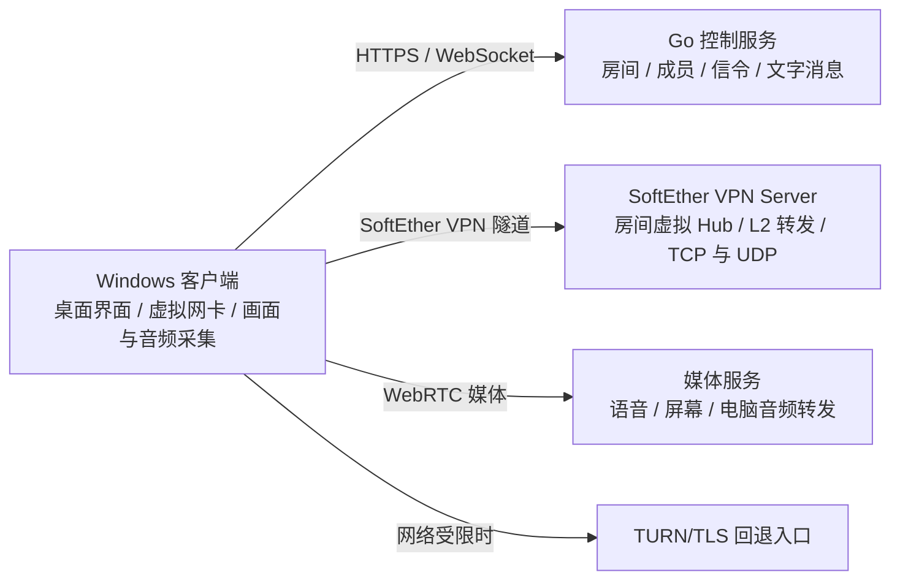

# 远程组网软件：需求与架构基线

版本：0.1（需求讨论稿）

## 1. 产品目标

提供 Windows 桌面客户端，以及可部署在 Linux 或 Windows 上的服务端。用户进入同一房间后，可以通过虚拟网络互访，使用房间文字聊天、语音聊天和屏幕共享。产品重点是远程组网；屏幕共享用于观看，不提供远程鼠标或键盘控制。

## 2. 已确认范围

- 首版客户端平台：Windows。
- 服务端平台：Linux、Windows。
- 房间是成员、虚拟网络流量、聊天和媒体流的隔离边界。
- 组网流量通过服务器中继；客户端到服务端优先使用 UDP，提供 TCP/TLS 回退。
- 虚拟网络承载房间内 TCP 和 UDP 流量。
- 需要支持局域网广播发现，使房间成员可以发现依赖局域网发现机制的游戏或软件。
- 房间提供文字聊天、语音聊天和屏幕共享。
- 屏幕共享只观看，不接受远程控制输入。
- 共享电脑正在播放的音频；可与共享画面、麦克风语音一起传输。
- 共享分辨率档位：1080p、1440p、2160p（4K）。帧率上限目标为 120fps。

## 3. 建议架构

- **控制服务**：处理登录、建房、邀请、成员权限、在线状态、信令和文字消息。
- **组网核心**：优先采用 SoftEther VPN Server/Client。控制服务为每个房间建立独立 Virtual Hub，并为成员创建单独的 VPN 用户；Virtual Hub 承载二层以太网和广播发现。SoftEther 的协议支持 TLS/TCP 与 UDP 混合传输，客户端依网络环境选用可用路径。
- **媒体服务**：使用 SFU 转发客户端编码后的语音、屏幕画面和系统音频。共享端负责采集与编码，服务端负责转发。
- 房间虚拟 Hub 不桥接到服务端或客户端的真实物理 LAN，避免把房间广播扩散到用户原有网络。
- 首版可把控制服务、SoftEther VPN Server 和媒体服务部署在同一台 Windows 或 Linux 主机上，保留独立进程和独立扩容能力。两种系统都要提供相同的房间、转发和运维能力。

## 4. 屏幕共享质量

分辨率与帧率作为独立设置，建议每个分辨率提供 30、60、120fps 选项，自动模式根据网络和设备能力调节。120fps 是上限目标；是否达到取决于采集、硬件编码、客户端解码和实际网络带宽。

初版可由共享者选择一个画质档位，由 SFU 转发该媒体流。后续再增加面向不同观看者的独立画质订阅或多层编码，以适应观看端带宽差异。

Windows 可评估 Windows.Graphics.Capture 作为屏幕采集接口，WASAPI loopback 作为系统播放音频采集接口。

## 5. 广播发现方案

局域网广播发现已确认是必需功能。每个房间映射为隔离的 SoftEther Virtual Hub，由 Hub 转发以太网帧并学习 MAC 地址，覆盖 ARP、IPv4 UDP 广播和组播发现。Windows 客户端通过 SoftEther VPN Client 的虚拟网络适配器加入 Hub；管理员权限、驱动签名和客户端安装体验需要在安装包设计中处理。

## 6. 尚未确定的工程选择

- SoftEther 版本固定、服务安装和 vpncmd 控制流程。
- Windows 客户端自动安装/管理 SoftEther VPN Client 与虚拟网卡。
- 目标游戏/软件样本，可用于定义并验证广播发现兼容范围。
- 所选媒体服务是否能在 Windows 和 Linux 上以同等能力稳定部署。LiveKit 提供 Windows 服务端下载版本，但其生产自托管部署指南主要以 Ubuntu/Amazon Linux 为验证环境，Windows 部署需要单独验证。

已选实现栈：Go 服务端（Windows/Linux），.NET 9 WPF 桌面客户端（Windows）。

## 7. 当前实现进度

- Go 服务端已有健康检查、可自定义房间 ID 与密码的建房和加入、房间成员状态和实时文字聊天接口。ID 或密码留空时自动生成；旧邀请码可继续作为密码使用。
- 服务端已加入 SoftEther 管理适配：建房创建隔离 Virtual Hub、独立 DHCP 网段和成员 VPN 账号；入房创建独立账号，API 返回连接资料。该联动尚未经过真实 SoftEther 环境验证。
- Windows 客户端已有建房、加入房间、成员列表、文字聊天和复制房间 / VPN 信息界面；虚拟网卡连接仍需手动使用 SoftEther VPN Client。
- 房间和成员令牌写入状态文件；最近 100 条聊天消息仍只保存在内存中。
- 客户端自动组网、语音、屏幕和电脑音频共享尚待实现。

## 8. 参考资料

- [LiveKit SFU 架构](https://docs.livekit.io/reference/internals/livekit-sfu/)
- [LiveKit 自托管部署与 TURN/TLS](https://docs.livekit.io/transport/self-hosting/deployment/)
- [LiveKit 服务端及 Windows 下载入口](https://github.com/livekit/livekit)
- [Windows.Graphics.Capture 屏幕采集](https://learn.microsoft.com/en-us/windows/apps/develop/graphics/screen-capture)
- [WASAPI loopback 音频采集](https://learn.microsoft.com/en-us/windows/win32/coreaudio/loopback-recording)
- [WireGuard Wintun：Windows 三层 TUN 驱动](https://github.com/WireGuard/wintun)
- [OpenVPN tap-windows6：Windows TAP 驱动](https://github.com/OpenVPN/tap-windows6)
- [SoftEther 二层以太网虚拟网络](https://www.softether.org/features/2._Layer-2_Ethernet_based_VPN)
- [SoftEther 协议规格：以太网载荷、TLS/TCP 与 UDP 混合传输](https://www.softether.org/spec)
- [SoftEther 开源许可与下载平台](https://www.softether.org/5-download/src)
- [SoftEther vpncmd 管理工具](https://www.softether.org/4-docs/1-manual/6/6.1)
